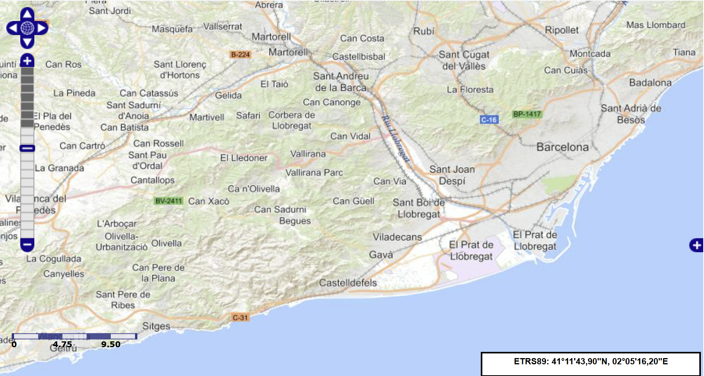
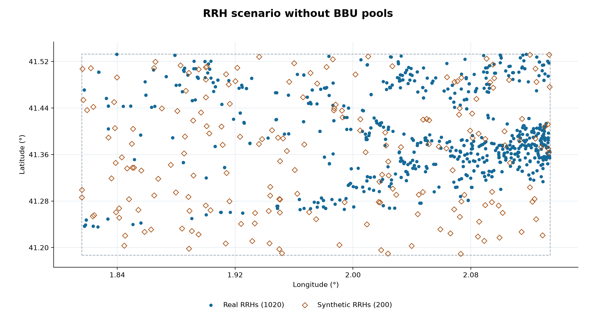

# C-RAN Fronthaul Planning and BBU Pool Placement

This project assigns remote radio heads (RRHs) to baseband unit (BBU) pools in the Barcelona metropolitan area. It tests consecutive pool counts to find the minimum feasible K in a deterministic, nested placement sequence, subject to distance and round-trip propagation delay limits.



Study bounds are `(1.815856, 41.186855, 2.133773, 41.532925)` in west, south, east, north order. Station records come from Spain's [Infoantenas portal](https://geoportal.minetur.gob.es/VCTEL/vcne.do).

## Install and run

Use Python 3.10 or later. Run these commands in PowerShell from the project directory:

```powershell
py -3 -m pip install -r requirements.txt
py -3 extract_infoantenas.py
py -3 process_stations.py
py -3 select_bbu_pools.py
py -3 plot_bbu_results.py
```

Extraction requires internet access. Skip extraction to reuse an existing raw CSV. If the processed dataset already reflects your scenario and traffic settings, start with pool selection.

Install dependencies with the same interpreter used to run the scripts. Requirements are `matplotlib` for figures, `PyYAML` for configuration, and `openpyxl` for creating and reading the Excel workbook. **`openpyxl` is required during normal execution, even without tests.** A package installed in the project's `.venv` is not necessarily available to `py -3`.

To use the project virtual environment, replace `py -3` in every command, including installation, with `.\.venv\Scripts\python.exe`. On macOS or Linux, use `python3`.

| Script | Purpose | Output |
| --- | --- | --- |
| `extract_infoantenas.py` | Retrieves stations and available assigned frequency bands within the study bounds. | `dataset/stations_raw.csv` |
| `process_stations.py` | Cleans and deduplicates records, classifies real 4G/5G stations, adds synthetic RRHs, and assigns traffic profiles. | `dataset/stations_for_simulation.csv` |
| `select_bbu_pools.py` | Searches consecutive K values and assigns RRHs to their closest feasible active pools. | Six CSV files and `bbu_pool_rrhs.xlsx` in the selected results directory. |
| `plot_bbu_results.py` | Generates scenario, assignment, distance, coverage, and connectivity plots. | Ten PNGs in the results directory's `figures/` folder. |

## Configuration

Edit [config.yaml](config.yaml); `settings.py` loads and validates its settings. Restart a script after changing YAML. The following excerpt reflects the current configuration; retain the other settings in the actual file:

```yaml
scenario:
  study_bounds: [1.815856, 41.186855, 2.133773, 41.532925]
  synthetic_rrhs: 200
  seed: 42

min_delay:
  max_round_trip_delay_us: 200
  propagation_speed_m_per_s: 300000000
  max_link_distance_km: 4.5
  candidate_pool_count: 30

traffic_profiles:
  mode: random
  random_percentages:
    residential: 20
    office: 30
    mixed: 50
  geographic_zones: []

paths:
  results_dir: results
  min_delay_subdir: min_delay_from_30
  figures_dir: figures
```

- `synthetic_rrhs` controls how many additional RRHs are uniformly sampled within the study bounds. Set it to zero to use only real records. Synthetic RRHs also participate in pool selection.
- `seed` makes synthetic positions and random traffic assignment reproducible for the same input and settings.
- `candidate_pool_count` is the starting K, not the final count. A starting value above the number of distinct candidate coordinates is capped at the available sites.
- `min_delay_subdir` names the output folder beneath `results_dir`. Changing K does not automatically rename this folder; change it too, or use `--results-dir`, to preserve separate runs.
- Other YAML sections configure extraction requests, frequency proxies, Earth radius, output filenames, and figure appearance.

Dataset and results directories resolve relative to the project directory unless absolute. The figure directory resolves relative to the selected results directory unless absolute. Explicit relative command-line paths resolve relative to the working directory. Use plain filenames for CSV and image filename settings. In Windows YAML paths, use forward slashes or single-quoted strings containing backslashes.

Rerun extraction and downstream steps after changing study bounds. Rerun processing and downstream steps after changing synthetic RRHs, seed, traffic settings, or technology classification. Rerun selection and plotting after changing starting K or link limits.

### Traffic profiles

Every real and synthetic RRH receives a `residential`, `office`, or `mixed` profile.

- In `random` mode, percentages must sum to 100. They are sampling probabilities, so observed shares can differ slightly.
- In `geographic` mode, add zones containing `profile` and `bounds: [west, south, east, north]`. The first matching zone applies; RRHs outside all zones are labelled `mixed`. No geographic zones are currently configured.

Assignment maps distinguish traffic profiles by RRH colour and assigned pools by link colour. Unserved RRHs have red crosses.

## Consecutive-K search

Candidate sites use distinct RRH coordinates, preferring real records at shared real/synthetic coordinates. Farthest-first placement creates a deterministic sequence: the K-pool layout uses the first K sites, and K+1 adds the next site. This nesting ensures that adding pools cannot worsen nearest-pool distances or coverage.

The program first evaluates `candidate_pool_count`:

1. If any RRH is unserved, increase K by one until all RRHs are served.
2. If all RRHs are served, decrease K by one until the first failure, then select the preceding feasible K. Stop at K=1 if it remains feasible.

If the minimum feasible K is 31, a start at 25 tests `25, 26, ..., 31`. A start at 34 tests `34, 33, 32, 31, 30` and selects 31. **Every tested K, including the failed boundary value, is saved in `k_search.csv` and plotted in `distance_vs_k.png`.**

This finds the minimum K within the nested placement sequence. It does not prove a global minimum across other pool locations or combinations of sites.

### Link limits

A feasible link has distance **at most** `max_link_distance_km` and RTT **strictly below** `max_round_trip_delay_us`:

```text
round_trip_delay_us = 2 * distance_km * 1,000,000,000 / propagation_speed_m_per_s
```

Each RRH chooses the closest feasible active pool, which also gives the lowest propagation delay at the configured constant speed. An RRH with no feasible pool is unserved.

At 300,000,000 m/s, the strict 200 microsecond threshold permits distances strictly below 30 km. The additional configured 4.5 km limit is tighter and corresponds to 30 microseconds of RTT.

## Outputs

The current configuration saves minimum-delay outputs under `results/min_delay_from_30/`.

| File | Contents |
| --- | --- |
| `scenario_rrhs.csv` | RRH IDs, coordinates, synthetic flags, and traffic profiles. |
| `bbu_pools.csv` | Pool IDs, candidate RRH IDs, coordinates, and initial/final activity flags. |
| `nearest_pool_assignments.csv` | Per-stage RRH status, optimal pool, distance, RTT, and feasible pool IDs/count. |
| `k_comparison.csv` | Initial, expanded when applicable, and final stage summaries: K, coverage, distance statistics, served RTT, and link limits. |
| `feasible_links.csv` | Every feasible RRH-to-pool link and its category at each reported stage. |
| `k_search.csv` | Every tested K in search order, active pool IDs, feasibility (`accepted`), coverage, and distance statistics. |
| `bbu_pool_rrhs.xlsx` | Summary category counts and per-pool categorized RRH lists. |

`k_comparison.csv` contains stage snapshots; use `k_search.csv` for the full tested sequence. The `expanded` stage appears only when K increases above its starting value.

### Excel workbook

The workbook contains **tables only**:

- **Read me:** category definitions and units.
- **Summary:** three category counts and total feasible RRHs per active pool and reported stage.
- **BBU_XX:** that pool's RRH lists, including stage, category, traffic profile, coordinates, distance, RTT, optimal pool, and alternative pool IDs. Filter `Stage` to `final` for the selected layout.

Categories are recalculated for each stage:

1. **Only feasible pool:** the RRH has no other feasible connection.
2. **Optimal pool with alternatives:** this pool is the closest choice, and other feasible pools exist.
3. **Feasible but not optimal:** this pool is a backup; another pool is the closest choice.

### Figures

The `figures/` subdirectory contains:

| Filename | Plot |
| --- | --- |
| `scenario_without_pools.png` | RRH locations before assignment, distinguishing real and synthetic records. |
| `min_delay_assignments_initial.png`, `min_delay_assignments_final.png` | Initial/final assignments, traffic profiles, and unserved RRHs. |
| `distance_vs_k.png` | Maximum, 95th-percentile, and mean distance for every tested K, with the effective link limit and chosen K. |
| `distance_distribution.png` | CDF of nearest-active-pool distances for the reported stages, including unserved RRHs. |
| `min_delay_coverage.png` | Served/unserved counts and coverage percentages. |
| `min_delay_pool_categories_initial.png`, `min_delay_pool_categories_final.png` | Three category counts per pool. |
| `min_delay_rrh_options_initial.png`, `min_delay_rrh_options_final.png` | Feasible pool count per RRH. |

Category PNGs remain part of the figure output. Maps use independently scaled longitude and latitude axes when `plot.map_aspect` is `auto`.

## Saved scenario and results

The saved dataset contains **1,590 raw records**, **1,020 classified real RRHs**, and **200 synthetic RRHs**: **1,220 RRHs at 819 distinct candidate coordinates**. Real classifications comprise 307 4G, 93 5G, and 620 supporting both. These labels are frequency-based estimates marked `frequency_inferred`.

| Saved run | Tested K values | Selected K | Final coverage |
| --- | --- | ---: | ---: |
| `results/min_delay_from_30/` | 30, 31, 32, 33, 34, 35 | 35 | 1,220/1,220 |
| `results/min_delay_from_40/` | 40, 39, 38, 37, 36, 35, 34 | 35 | 1,220/1,220 |

At K=34, one RRH remains unserved. At K=35, maximum nearest-pool distance is **4.368 km**, the 95th percentile is **3.622 km**, mean distance is **2.193 km**, and maximum served RTT is **29.121 microseconds**. Live extraction can change as the portal's records change.



See the [final assignment map](results/min_delay_from_30/figures/min_delay_assignments_final.png), [distance-versus-K chart](results/min_delay_from_30/figures/distance_vs_k.png), and [Excel workbook](results/min_delay_from_30/bbu_pool_rrhs.xlsx).

## Command-line overrides

To keep a separate run starting at 40 pools:

```powershell
py -3 select_bbu_pools.py --candidate-pools 40 --results-dir results/min_delay_from_40
py -3 plot_bbu_results.py --results-dir results/min_delay_from_40
```

Use the same results directory for selection and plotting. Processing accepts a positional raw CSV, `--output`, `--synthetic`, and `--seed`. Selection accepts a positional processed CSV. Plotting accepts `--figures-dir`. A custom processing input writes the configured processed filename beside that input unless `--output` is supplied.

## Tests and result validation

Run the offline tests:

```powershell
py -3 -m unittest discover -s tests -v
```

Tests cover configuration, CLI overrides, traffic modes, consecutive-K searches, link limits, Excel tables, and figure generation. Network requests are mocked in the configuration tests.

After selection and plotting, independently audit generated results:

```powershell
py -3 tests/validate_phase_results.py
```

This audits the YAML-configured results directory and writes `results/validation/audit.json`. To audit another run:

```powershell
py -3 tests/validate_phase_results.py --results-dir results/min_delay_from_40 --report results/validation/audit_min_delay_from_40.json
```

The audit independently recalculates distances, feasible links, optimal assignments, coverage, category counts, and consecutive-K transitions. It verifies the Excel lists and summary totals, absence of workbook charts, and expected figure files.
