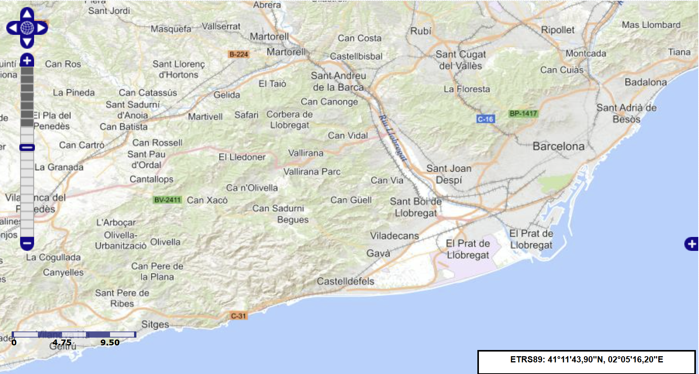
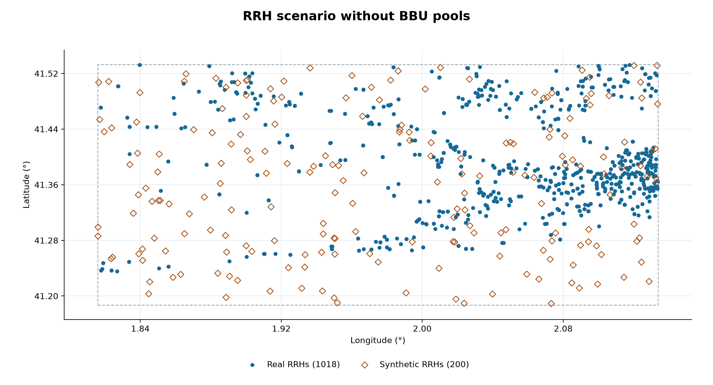

# C-RAN Fronthaul Planning and BBU Pool Placement

This project compares the number and placement of baseband unit (BBU) pools for remote radio heads (RRHs) in an expanded study area in the Barcelona metropolitan area. The study bounds are `(1.815856, 41.186855, 2.133773, 41.532925)` in west, south, east, north order.



*Study area shown in the [Infoantenas map viewer](https://geoportal.minetur.gob.es/VCTEL/vcne.do).*

## Included scenario

The included dataset contains **1,587 raw station records**. After cleaning and technology classification, the simulation contains **1,018 real RRH records and 200 synthetic RRHs**, for a total of **1,218 RRHs**. Multiple records can share a coordinate pair; candidate BBU locations use distinct coordinates.

The saved results compare **K = 5, 10, 15, 20, 25, and 30** BBU pools. Maximum nearest-pool distance decreases from **15.83 km** at K = 5 to **4.68 km** at K = 30.



Scenario maps use a landscape layout with independently scaled longitude and latitude axes. See the [placement with 30 pools](results/figures/scenario_k_30.png), [distance comparison](results/figures/distance_vs_k.png), and [distance distribution](results/figures/distance_distribution.png) for the resulting coverage patterns.

## Run the pipeline

Use Python 3.10 or later. Run these commands in PowerShell from the folder containing all four scripts. On macOS or Linux, use `python3` in place of `py -3`. Internet access is required for extraction, and Matplotlib is required for plotting.

The defaults in `config.yaml` use the same RRH counts and pool counts as the included scenario, with seed 42 for reproducible synthetic locations. To use the included raw dataset, start with the processing step after installing dependencies.

```powershell
py -3 -m pip install -r requirements.txt
py -3 extract_infoantenas.py
py -3 process_stations.py
py -3 select_bbu_pools.py
py -3 plot_bbu_results.py
```

| Step | What it does | Output |
| --- | --- | --- |
| Extract | Queries Spain's Infoantenas portal for stations and available assigned frequency bands. | `dataset/stations_raw.csv` |
| Process | Cleans and deduplicates station records, then retains those classified as 4G, 5G, or both. | `dataset/stations_for_simulation.csv` |
| Place pools | Tests each requested pool count with farthest-first k-center and assigns every RRH to its nearest selected pool. | Four CSVs in `results/` |
| Plot | Draws the RRH scenario without pools, a placement map for each K, and distance comparison and distribution charts. | PNGs in `results/figures/` |

## Configure and interpret

Edit **[`config.yaml`](config.yaml)** to change settings for all four scripts. `settings.py` loads the YAML automatically; it contains no scenario defaults to edit. Restart a script after changing the configuration. For example:

```yaml
scenario:
  study_bounds: [1.815856, 41.186855, 2.133773, 41.532925]
  synthetic_rrhs: 200
  seed: 42
  pool_counts: [5, 10, 15, 20, 25, 30]
```

The other YAML sections configure input/output directories and filenames (`paths`), Infoantenas requests (`extraction`), frequency proxies and Earth radius (`model`), and figure sizes, colors, resolution, and map padding (`plot`). Dataset and results directories are relative to the project directory unless absolute paths are supplied. The figure directory is relative to the results directory unless absolute. Use plain filenames for the CSV and image filename settings. In Windows YAML paths, use forward slashes, for example `D:/planning/results`, or single-quoted strings for paths containing backslashes.

- **Study bounds** are defined once in `scenario.study_bounds`, in west, south, east, north order. Extraction, processing, and plotting all use this value. Rerun the pipeline after changing the study area; existing datasets and figures are not automatically regenerated.
- **Synthetic RRHs** default to `scenario.synthetic_rrhs` (200). They are uniformly sampled within the full study bounds, flagged, and also participate in pool selection. Set this to zero for a scenario containing only real station records.
- **Pool counts** default to `scenario.pool_counts`. Each K must be a positive integer no larger than the number of distinct RRH coordinates.
- **Command-line overrides** still work for individual runs: `--synthetic`, `--seed`, `--k`, positional input CSV paths, processing `--output`, and `--results-dir` for placement and plotting. Plotting also accepts `--figures-dir`. Explicit relative command-line paths are relative to the working directory. When overriding `--results-dir`, use the same directory for placement and plotting. A custom processing input writes beside that input unless `--output` is supplied.
- **Results** include `scenario_rrhs.csv` for RRH coordinates, `bbu_pools.csv` for selected locations, `nearest_pool_assignments.csv` for per-RRH assignments and distances, and `k_comparison.csv` for maximum, 95th-percentile, and mean distance by K. Start with the maximum distance to compare how the worst-served RRH changes as pools are added.
- **Model assumptions** include frequency-based estimates when technology labels are unavailable, flagged as `frequency_inferred`. Distances are great-circle distances in kilometres. Fibre routing, latency, and pool capacity are outside this model.
